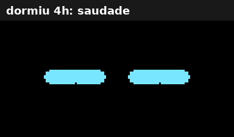

# 🤖 Robô Chaveiro

Um bichinho de bolso feito com ESP32-C3 e uma telinha OLED. Ele pisca, respira, olha em volta, faz careta sozinho, tem minijogos, lembra de você e dorme quando é esquecido.



> O GIF acima é uma simulação do próprio firmware: o código foi compilado no PC com a biblioteca gráfica de verdade e cada quadro da tela foi salvo como imagem.

---

## ✨ O que ele faz

**Olhos 100% próprios**, desenhados à mão com a Adafruit GFX (sem lib de olhos pronta). Cada parte do rosto é um parâmetro que "persegue" um alvo a cada quadro, então uma expressão derrete na outra em vez de pular.

**Vida própria**
- Pisca (às vezes duas vezes seguidas), respira e olha em volta
- O olho do lado pra onde ele olha cresce, como se estivesse curioso
- Quando você aperta o botão, ele para tudo e te encara
- De tempos em tempos faz uma mania sorteada: risada, piscadinha, "ué?", susto, suor frio, olhar desconfiado, coração, glitch hacker e uma choradinha rara

**Humores** (um clique troca): neutro → feliz → cansado → bravo → apaixonado → hacker

**Memória** (sobrevive ao sono profundo)
- **Afeto (0–100):** sobe quando você clica, joga e bate recorde; cai se ele for esquecido por horas ou se você irritar ele. Afeto alto deixa as manias mais felizes, afeto baixo deixa ele carente
- **Saudade:** sabe quanto tempo dormiu. Mais de 3 h sem você → acorda com coração. Acordado de novo em menos de 2 min → acorda ranzinza
- **Recordes** dos três jogos

**Minijogos** (tudo com um botão só)
- **Dino:** pula os obstáculos
- **Flappy:** passa pelos canos
- **Tiro Certo:** toca na hora que o cursor tá dentro da zona

Ao voltar do jogo ele reage: recorde vira corações de orgulho, partida ruim vira risada de canto.

**Economia de energia:** com 4 min parado ele fica com sono e a tela escurece; com 5 min fecha os olhos, solta uns "Z" e entra em sono profundo. O botão acorda.

---

## 🎮 Controles

| Onde | Ação | Resultado |
|---|---|---|
| Olhos | 1 clique | troca o humor |
| Olhos | 2 cliques | abre o menu |
| Menu | toque | próximo item |
| Menu | segurar | entra no item |
| Jogo | toque | ação (pular, bater asa, atirar) |
| Jogo | segurar | volta pro menu |
| Fim de jogo | soltar | joga de novo |
| Status | toque | volta pro menu |
| Dormindo | toque | acorda |

Cutucar demais (8 cliques em 4 s) deixa ele irritado. 😤

---

## 🔧 Hardware

| Peça | Observação |
|---|---|
| ESP32-C3 SuperMini | qualquer C3 serve, ajustando os pinos |
| OLED 0.96" SSD1306 128x64 I2C | 4 pinos: GND, VDD, SCK, SDA |
| Botão táctil 6x6 | |
| Chave slide SS12D00 | liga/desliga de verdade (corta a bateria) |
| Módulo TP4056 USB-C **com proteção** | o de 6 pinos (com OUT+/OUT-) |
| Bateria LiPo 3.7 V | 602030 de 300 mAh (versão chaveiro) ou a do controle de PS4 (versão maior) |

As baterias do projeto foram reaproveitadas de um fone bluetooth e de um controle de PS4.

### Ligação

```
OLED VDD  → 3V3          OLED GND → GND
OLED SDA  → GPIO8        OLED SCK → GPIO9  (SCK = SCL)
Botão     → GPIO4 e GND

Bateria (+/-) → TP4056 (B+/B-)
TP4056 OUT+   → pino do MEIO da chave slide
Ponta da chave → 5V do C3
TP4056 OUT-   → GND do C3
```

- O botão **precisa** estar num GPIO de 0 a 5: no C3 só esses acordam o chip do sono profundo
- Nunca ligue a bateria direto no 3V3 (cheia ela tem 4,2 V)
- Carregue pela USB do TP4056, não pela do C3, e não deixe as duas plugadas ao mesmo tempo

---

## 💾 Firmware

1. Arduino IDE com o pacote **esp32** da Espressif
2. Placa: **ESP32C3 Dev Module**
3. Bibliotecas: **Adafruit SSD1306** e **Adafruit GFX** (o gerenciador oferece instalar as dependências junto)
4. Abra `firmware/robo_chaveiro_v4/robo_chaveiro_v4.ino` e suba

**Dicas**
- Tela preta? Troque o endereço `0x3C` por `0x3D` no `display.begin`
- Dormindo, a USB do C3 some e o upload falha. Acorde ele no botão antes de subir código. Se apagar no meio, segure o **BOOT** da placa enquanto pluga o USB
- Cada sketch precisa da sua própria pasta, com o mesmo nome do `.ino`. A IDE compila todos os `.ino` de uma pasta juntos

### Ajustes rápidos

Tudo fica em constantes no topo do arquivo:

| Constante | O que muda |
|---|---|
| `TEMPO_CANSADO` / `TEMPO_DESLIGAR` | quando ele fica com sono e quando apaga (pra testar, use 15000 e 20000) |
| `GESTO_MIN` / `GESTO_MAX` | intervalo entre as manias |
| `GESTOS[]` | quais manias saem e com que frequência (quanto mais repetida na lista, mais sai) |
| `SPAM_LIMITE` / `SPAM_JANELA` | quão fácil é irritar ele |
| `BRILHO_*` | brilho acordado, cansado e dormindo |
| `PULO`, `FL_GRAV`, `TIRO_VEL_INICIAL`... | dificuldade dos jogos |

---

## 🧠 Como funciona por dentro

```
 Telas:
   OLHOS ──2 cliques──► MENU ──segurar──► JOGO ──segurar──► MENU
                         │
                         ├──segurar em "Status"────► STATUS ──toque──► MENU
                         └──segurar em "<- Olhos"──► OLHOS

 Ciclo de vida:
   ACORDADO ──4 min──► CANSADO ──5 min──► DORMINDO ──► sono profundo
       ▲                                                    │
       └──────────────── botão (o C3 reinicia) ◄────────────┘
```

- **Máquina de estados** para as telas (`OLHOS`, `MENU`, `JOGO`, `TELA_STATUS`) e para o ciclo de vida (`ACORDADO`, `CANSADO`, `DORMINDO`)
- **Reações temporárias:** cada careta tem duração e depois volta sozinha pro humor de fundo
- **Expressões por interpolação:** pálpebras de sono, de raiva e de tristeza, o arco de feliz, abertura e altura de cada olho são valores que se aproximam do alvo a cada quadro (~40 fps)
- **Modos especiais de desenho:** coração, espiral, olhão de susto e hacker trocam o jeito de desenhar, com uma piscada pra disfarçar a troca
- **Memória RTC:** afeto, recordes e a hora em que dormiu ficam na memória que sobrevive ao sono profundo (zera se desligar na chave). O relógio interno do C3 continua contando dormindo, e é assim que ele sabe quanto tempo ficou sozinho
- **Botão com debounce** e detecção de clique simples, duplo e longo

---

## 🖨️ Case 3D

Modelado em OpenSCAD, paramétrico, em `case/`. Tem duas versões, escolhidas pela variável `bateria`:

| Versão | Tamanho externo |
|---|---|
| `"fone"` (602030) | 39,5 x 37,2 x 21,2 mm |
| `"ps4"` (DualShock 4) | 64,2 x 40,2 x 23,3 mm |

- Imprima a frente com a tela virada pra mesa e a tampa com a aba pra cima. Nenhuma peça precisa de suporte
- Tampa por pressão. Dura ou frouxa? Ajuste `folga`
- Meça as suas peças e ajuste a seção `COMPONENTES` do `.scad` antes de imprimir

---

## 🗺️ Próximos passos

- [ ] Montagem final com bateria e case impresso
- [ ] Buzzer para bipinhos de robô
- [ ] Acelerômetro MPU6050: sacudiu, fica tonto; pegou na mão, acorda
- [ ] Leitura da bateria (divisor de tensão) e cara de fome com bateria fraca
- [ ] Separar o firmware em abas (`olhos.h`, `jogos.h`, `sono.h`)

---

## 📁 Estrutura

```
├── firmware/robo_chaveiro_v4/robo_chaveiro_v4.ino
├── case/
│   ├── case_robo.scad
│   ├── case_frente_fone.stl   case_tampa_fone.stl
│   └── case_frente_ps4.stl    case_tampa_ps4.stl
└── docs/
    └── preview_v4.gif
```

---

Feito por [Lucas Eduardo](https://github.com/Lucaseduardo1204).
